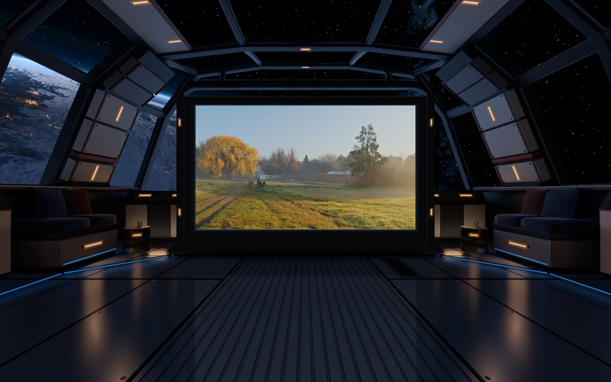
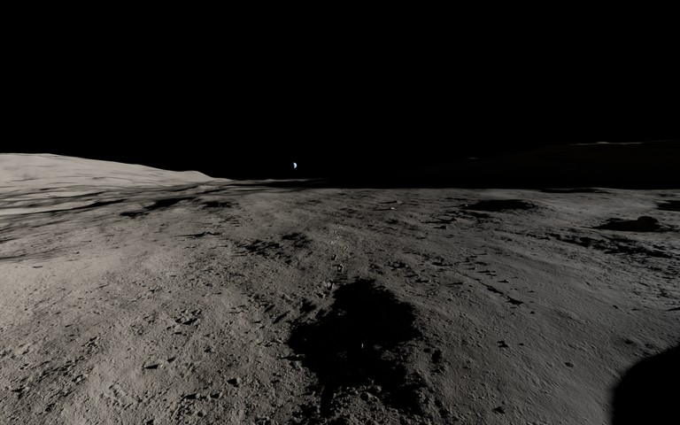
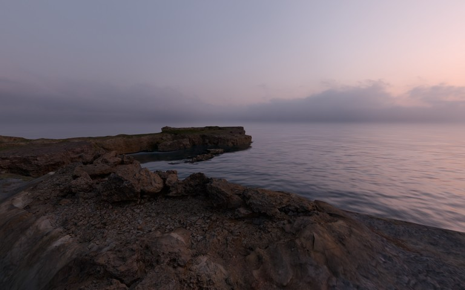
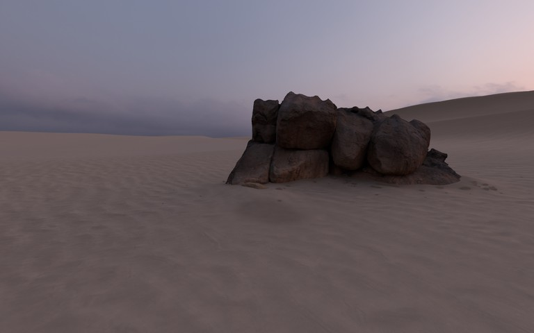
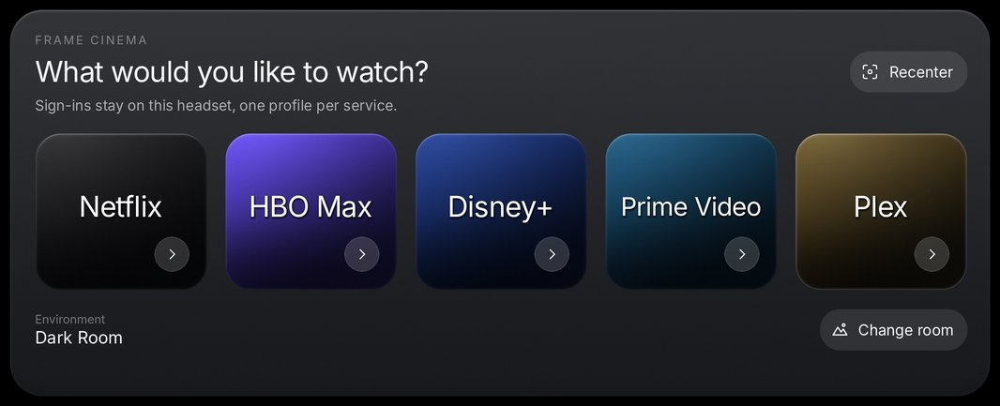

# Frame Cinema

Frame Cinema is a free cinema app I'm building for Steam Frame. Watch Netflix,
HBO Max, Disney+, Prime Video or your Plex library on a big screen, on the Moon,
by the sea, in the desert, or in a spacecraft lounge above Earth. There's a
plain dark room, too.

[Download on itch.io](https://sframelab.itch.io/frame-cinema) ·
[Support the project on Patreon](https://www.patreon.com/sframelab)



The app runs on the headset. Chrome plays the video, and Godot draws the room
around it. Each service has a separate browser profile, so your sign-ins stay
on the headset between sessions.

| Moon | Coast | Desert |
|---|---|---|
|  |  |  |



These images are renders from the app.

This is version 0.5.20. It runs at 72 Hz on SteamOS ARM64. Picture quality
depends on the service, your subscription and what the service offers in a Linux
browser. Frame Cinema is independent and isn't affiliated with Valve or the
streaming services.

## Install

1. In Desktop Mode, install the **Google Chrome ARM64 Flatpak** from Discover.
2. Download `FrameCinema-0.5.20-installer.sh` and
   `Install Frame Cinema.desktop` from the
   [Releases page](https://github.com/sframelab/frame-cinema/releases) or
   [itch.io](https://sframelab.itch.io/frame-cinema). Keep both files in the
   same folder.
3. Double-click **Install Frame Cinema** and choose **Continue**. Setup takes a
   few minutes and restarts Steam to add the library entry.
4. Return to Gaming Mode and launch **Frame Cinema**, under **Non-Steam** in
   your library. If it's missing, run the installer again to repair the entry.

See [Getting started](release/GETTING-STARTED.md) for controls, troubleshooting
and uninstall instructions, or [Privacy](release/PRIVACY.md) for what the app
stores.

## Build and contribute

The repository contains the app source and build tools. Textures, meshes, Godot
and prebuilt native helpers come from the release download:

```sh
git clone https://github.com/sframelab/frame-cinema.git
cd frame-cinema
python3 tools/fetch_assets.py FrameCinema-0.5.20-installer.sh
python3 tools/build_on_frame.py          # run on the headset in Desktop Mode
```

The build script runs the tests, imports the project and makes the installer.
The room data and the prebuilt native programs come from the release download;
[Build and install](docs/build-and-install.md) says how each one is made.

- [Build and install](docs/build-and-install.md)
- [Rooms and how to add one](docs/rooms.md)
- [Architecture](docs/architecture.md)
- [Contributing](CONTRIBUTING.md)

## Repository layout

| Folder | Contents |
|---|---|
| `app/` | Godot project, launcher, browser bridge and most native helper sources |
| `release/` | Packager, installer, tests, user guides, licenses and Steam artwork |
| `rooms/observation-deck/` | Cabin generator, light baking, Earth and sky tools, preview renderer |
| `rooms/coast/tools/` | Coast floor geometry and lighting tools |
| `native/` | Pose and water reflection extensions |
| `tools/` | Asset fetching and build scripts |
| `docs/` | Developer guides |

## License and credits

Frame Cinema's own code is released under the MIT license; see [LICENSE](LICENSE). Third-party parts keep their own licenses; see [THIRD_PARTY_NOTICES.md](THIRD_PARTY_NOTICES.md).

Frame Cinema's own images (the icon, room pictures and screenshots) are under
the same license, except the pictures of the Observation Deck's sky.

The outdoor rooms use Poly Haven CC0 scans. The Earth and sky use NASA imagery,
ESA Gaia data and the Yale Bright Star Catalogue. The Milky Way files, the
pictures that show them and the 2D-to-3D mode are for non-commercial use only.
[Third-party notices](THIRD_PARTY_NOTICES.md) lists each file with its source
and terms.

Steam and Steam Frame are trademarks of Valve Corporation. Streaming-service
names belong to their respective owners.
