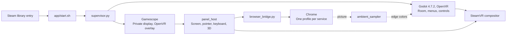

# Architecture

Frame Cinema starts several processes from one Steam library entry. Godot draws
the room and menus; Chrome plays the video. SteamVR composites the browser
surface over the room, keeping video out of Godot's rendering pipeline.

## Startup and process management

`app/start.sh` sets the SteamVR library path, OpenXR runtime and foveation
settings. It runs `preflight.py`, which the packager adds, to check requirements
such as Python and Chrome, then starts `supervisor.py`.

The supervisor starts Godot and manages the browser processes. Selecting a
service starts its browser group; returning to the library stops it. Services
and profile paths come from `app/services.json`. The supervisor does not accept
arbitrary URLs or profile folders. Processes exchange commands and status through
files in `$XDG_RUNTIME_DIR/frame-cinema`.

## Scene and menus

`app/main.tscn` and `app/cinema.gd` run the OpenXR session using Godot 4.7.2's
Mobile renderer with 2× MSAA, targeting 72 Hz. SteamVR draws the controllers.

- `cinema_ui.gd` builds the library and viewing menus.
- `cinema_rooms.gd` loads and switches rooms.
- `cinema_ambient.gd` turns sampled video colors into ambient lighting.

## Browser and video

Gamescope gives Chrome a private 1920×1080 display and exposes it as an OpenVR
overlay. `panel_host` aligns that overlay with the scene's screen and handles
the pointer, keyboard and optional 2D-to-3D mode. The 3D mode estimates depth
from a downscaled image using ZipDepth and ncnn.

`browser_bridge.py` launches Chrome in kiosk mode with a profile for the selected
service. It uses a pipe-based DevTools connection without opening a network
port. `media_control.py` sends fixed playback commands and reads numeric or
boolean state. Chrome handles sign-in, playback and DRM.

`ambient_sampler` reads a 384×216 thumbnail and narrow strips from the browser
surface. These provide edge colors for room lighting and black-bar boundaries
for **Fit picture**. Samples are processed locally and overwritten in the
private runtime folder. Local inspection hooks can also capture browser images;
see [Privacy](../release/PRIVACY.md).

## Native extensions

| Extension | Purpose |
|---|---|
| `native-ui` | Handles menu overlays, clicks and shortcuts; `native_ui_renderer` uploads menu textures |
| `scene-owner` | Tracks overlays owned by the active scene, including the screen and keyboard |
| `pose-sync` | Reads OpenXR timing so overlays align with the room on the same frame; does not change tracking |
| `water-sync` | Supplies the current frame's camera for water reflections |

## Files on the headset

| Data | Location |
|---|---|
| Installed versions | `~/.local/share/frame-cinema/app/versions/<version>` |
| Settings and app logs | `~/.local/share/FrameCinema` |
| Chrome profiles | `~/.var/app/com.google.Chrome/config/frame-cinema*` |
| Launch log | `~/.local/state/frame-cinema/launch.log` |
| Temporary status, samples and control files | `$XDG_RUNTIME_DIR/frame-cinema` |

## Packaging and installation

`release/build_public.py` removes tests, C++ sources, probes and editor caches
from a built project. It adds the user guides, license texts and Steam artwork,
checks referenced `res://` paths, then writes a reproducible archive with fixed
file order, timestamps and owners. It also creates the self-extracting installer
and `Install Frame Cinema.desktop` launcher.

`release/install.py` installs for the current user without administrator rights.
It verifies file hashes, imports Godot resources with XR off and adds the Steam
entry. It switches the active version after preparation succeeds and keeps the
previous version for rollback. An existing version cannot be overwritten.
